**I design and ship production-grade AI products, SaaS platforms, and cloud infrastructure, from first architecture sketch to scale.**

---

### About

Senior engineer with **8+ years** building software that has to work in production: reliable, observable, and cost-aware. I work end to end, covering product architecture, backend systems, polished frontends, and the infrastructure underneath them. Clients bring me in when they need someone who can own a problem and deliver without hand-holding.

### What I Do

| | Area | Typical work |
|:--:|:--|:--|
| 🤖 | **AI & LLM Engineering** | RAG systems, AI agents & tool-calling, LLM integration (OpenAI, Claude, open-source models), evals, vector search, AI-powered SaaS features |
| 🧩 | **Full-Stack SaaS** | Multi-tenant platforms, auth & billing (Stripe), dashboards, REST/GraphQL APIs, real-time features, MVP → production |
| ☁️ | **Cloud & DevOps** | AWS/GCP architecture, Docker & Kubernetes, Terraform, CI/CD pipelines, monitoring, cost optimization |
| ⚙️ | **Data & Automation** | ETL pipelines, scraping & integrations, workflow automation, background jobs, third-party API integrations |
| 🚀 | **Performance & Scale** | Profiling, caching, database tuning, migrating legacy systems, rescuing stalled projects |

### Tech Stack

<table>
  <tr>
    <td><b>Languages</b></td>
    <td>TypeScript · Python · Go · SQL</td>
  </tr>
  <tr>
    <td><b>Frontend</b></td>
    <td>React · Next.js · Tailwind CSS · React Native</td>
  </tr>
  <tr>
    <td><b>Backend</b></td>
    <td>Node.js · NestJS · FastAPI · Django · GraphQL · WebSockets</td>
  </tr>
  <tr>
    <td><b>AI / ML</b></td>
    <td>OpenAI & Anthropic APIs · LangChain / LangGraph · LlamaIndex · Hugging Face · pgvector · Pinecone</td>
  </tr>
  <tr>
    <td><b>Data</b></td>
    <td>PostgreSQL · MongoDB · Redis · Elasticsearch · Kafka</td>
  </tr>
  <tr>
    <td><b>Cloud & DevOps</b></td>
    <td>AWS · GCP · Vercel · Docker · Kubernetes · Terraform · GitHub Actions</td>
  </tr>
</table>

### Selected Work

<!-- Replace these with your real projects and real numbers. Measurable outcomes are what clients read first. -->

- **AI Knowledge Assistant (B2B SaaS)**: Built a RAG-based assistant over 50k+ internal documents with source citations and an evaluation pipeline. Cut support ticket volume by ~35%. 
  `Next.js` `FastAPI` `Claude API` `pgvector` `AWS`
- **Multi-Tenant Analytics Platform**: Architected and led delivery of a SaaS dashboard serving 200+ organizations, with role-based access, Stripe billing, and real-time metrics. 
  `TypeScript` `NestJS` `PostgreSQL` `Redis` `Kubernetes`
- **Infrastructure Modernization**: Migrated a monolith to containerized services with Terraform-managed infrastructure and zero-downtime CI/CD. Reduced cloud spend by ~40%. 
  `Docker` `Terraform` `GitHub Actions` `AWS ECS`

### How I Work

- **Ownership:** I scope and estimate the work, then deliver it. You get clear milestones, not surprises.
- **Communication:** async-friendly, with regular progress updates and written documentation.
- **Quality:** typed code, automated tests, code review, and CI from day one.
- **Production mindset:** logging, monitoring, security, and cost are part of the design, not afterthoughts.

### GitHub Activity

  
  

---

**Have a project in mind?** Let's talk → <a href="mailto:your-email@example.com">your-email@example.com</a>

